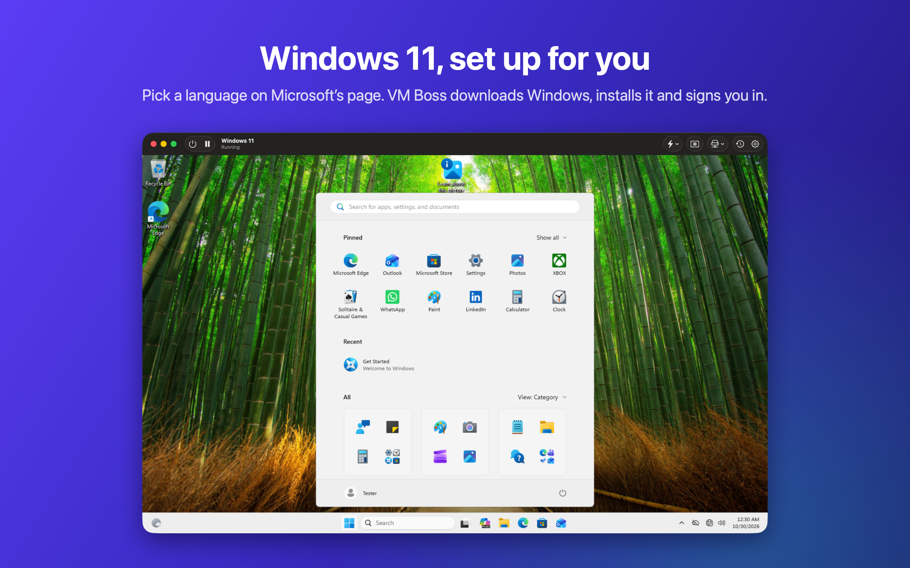
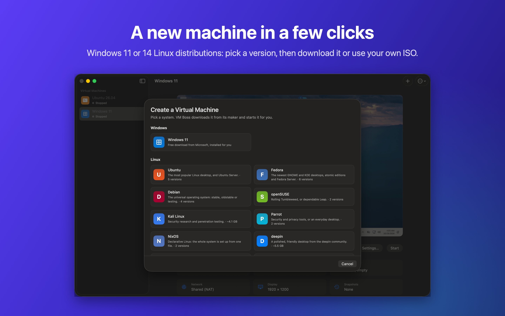

# VM Boss

Run Windows 11, Linux and Android side by side with your Mac, and keep your iPhone and iPad
simulators in the same library. Pick a system and VM Boss downloads it from its maker and
gets it running. There's nothing else to install.

**Website:** https://vm-boss.com

## What it does

- **Windows 11, set up for you.** Microsoft's download page opens inside VM Boss: pick a
  language, and VM Boss downloads Windows, installs it and signs you in. The display
  follows your window.
- **14 Linux distributions in 34 versions.** Ubuntu, Fedora, Debian, openSUSE, Kali Linux,
  Parrot, NixOS, deepin, AlmaLinux, Rocky Linux, CentOS Stream, Void Linux, Gentoo and
  Alpine, downloaded straight from each project or installed from your own ISO. Custom
  takes any other ARM64 Linux.
- **Android and iPhone.** The newest Android with Google Play on Google's Android Emulator,
  which VM Boss downloads for you, and iPhone and iPad devices from Xcode's iOS Simulator,
  for testing your apps.
- **Everyday tools.** Suspend and resume, snapshots, instant clones, a menu bar extra, and
  `vmctl` for the command line.

## Download

VM Boss needs a Mac with Apple silicon and macOS 14 Sonoma or later. Download the newest
disk image from [Releases](https://github.com/nader1414518/VMBoss-Public/releases), open it
and drag VM Boss to Applications.

## VM Boss Pro

Linux virtual machines are free. VM Boss Pro adds:

- Windows 11 virtual machines
- Android and iPhone devices
- Snapshots and instant clones
- The `vmctl` command-line tool

Every Pro feature is free to try for 14 days: choose **VM Boss › VM Boss Pro…** in the app.
Pro is a one-time purchase on [the website](https://vm-boss.com/#pro);
right after paying, you get a license key that activates it.

Windows isn't included: it downloads free from Microsoft, and you activate it with your own
license.

## Support

Email support@vm-boss.com, or [open an issue](https://github.com/nader1414518/VMBoss-Public/issues/new/choose)
for bugs and ideas.

## Privacy

VM Boss collects no data. See the [privacy policy](PRIVACY.md).

## Open-source components

VM Boss includes QEMU and other open-source software, listed with their licenses in
[THIRD-PARTY.md](THIRD-PARTY.md). Each release includes their exact source code.

---

Windows is a trademark of Microsoft Corporation. Android is a trademark of Google LLC.
Ubuntu is a trademark of Canonical Ltd. iPhone, iPad and Xcode are trademarks of Apple Inc.
VM Boss isn't affiliated with or endorsed by them.
